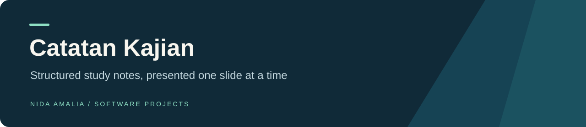
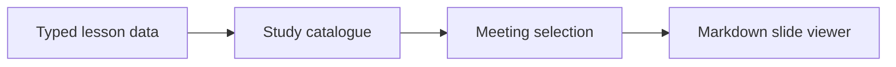

# Catatan Kajian

A React and TypeScript reading interface for structured study notes. Browse individual lessons or multi-session series, then read their Markdown content through an animated slide viewer.

## What to explore

- A study catalogue with metadata and tags.
- Single lessons and series containing multiple meetings.
- Markdown slide content with previous/next navigation.
- Shared, typed data structures for adding new study material.

## Run locally

Use Node.js 22 LTS and npm. The current reader loads bundled content; no AI API key is required for browsing it.

```bash
git clone https://github.com/nidaamalia/catatan-kajian.git
cd catatan-kajian
npm ci
npm run dev
```

Open http://localhost:5173.

```bash
npm run lint
npm run build
npm run preview
```

`lint` currently runs TypeScript checking.

## Content architecture



- [types.ts](src/data/types.ts): lesson, meeting, and slide contracts.
- [kajian.ts](src/data/kajian.ts): catalogue registration.
- [contoh-format.ts](src/data/kajians/contoh-format.ts): example content format.
- [SlideViewer.tsx](src/pages/SlideViewer.tsx): content selection and navigation.

## Adding material

Follow the existing typed example, add a unique lesson identifier, and register it in the catalogue. For a series, supply meeting identifiers and slide arrays. Keep source attribution with the material and review transcription accuracy before publishing.

## Scope

This is a curated reader, not a live transcription or AI summarisation service. Transcript-source files are separate from the reading UI. Accessibility, keyboard navigation, and long-content behaviour need dedicated evaluation; no automated coverage claim is made.
